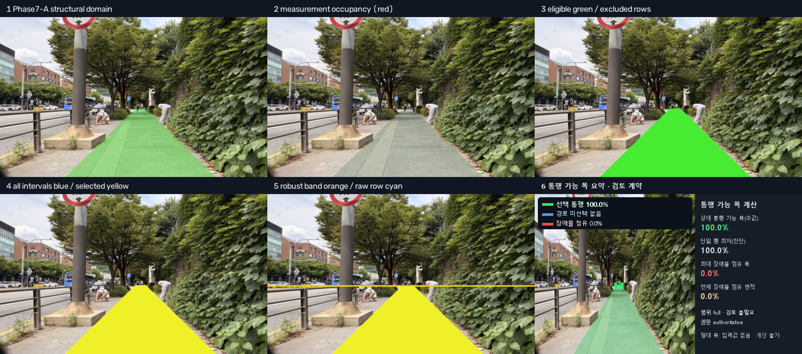
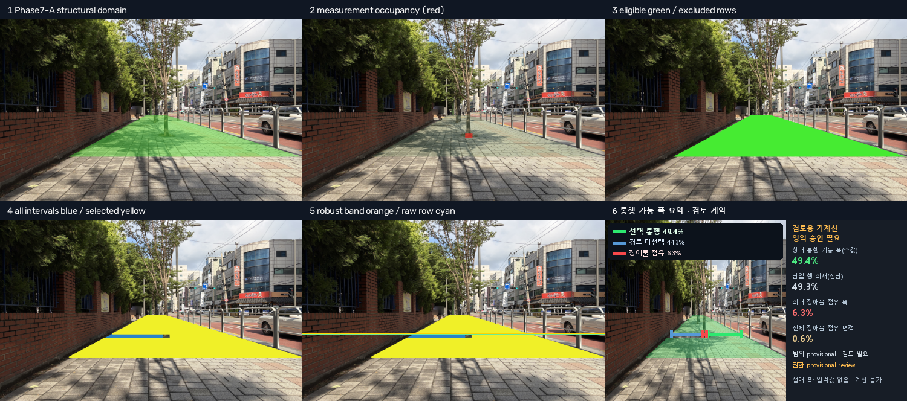
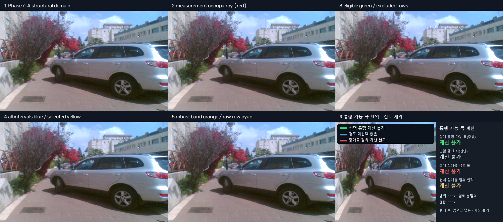
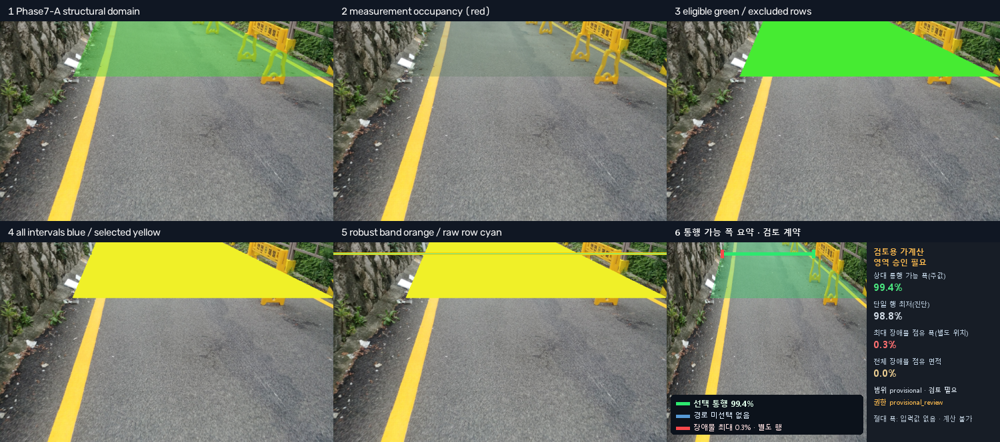
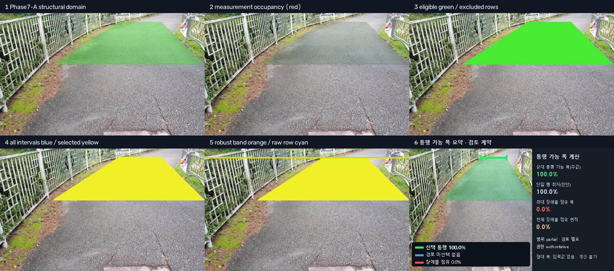
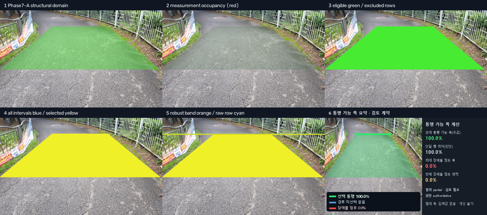

# RoadPush AI 최종 운영 로직과 백엔드 계약

상태: Phase 7-A 종료, Phase 7-B V2 구현 완료  
결과 schema: `phase7_b_result_v2`  
Phase 7-A policy: `phase7_extension_track_s1_v4_probe_human_review_grading`

이 문서는 팀원이 사진 입력부터 최종 폭 결과 소비까지 바로 구현할 수
있도록 현재 production 경로와 백엔드 계약을 한곳에 고정한다. Phase 7-B는
측정 계층이며, Phase 6 blocker나 Phase 7-A 경계를 수정하지 않고 사진만으로
미터 단위 폭을 추정하지 않는다.

## 1. 최종 아키텍처

```text
사진 입력
  -> EXIF 방향 보정 / 입력 hash / profile 검증
  -> Mapillary Mask2Former semantic map (cache 우선, 없으면 추론)
  -> 공통 obstacle geometry + 필요한 경우 YOLO11n-seg 1회
  -> Sidewalk / Road 후처리
     - surface ownership, blocker, 배수구 복구, sparse row-span support
  -> Phase 6 대표 surface 선택
  -> Phase 7-A 보도·도로 경계
     - V6 관측/직선 적합, S1 연장, 끝 해상도 정지,
       장애물 방향 검증 예외, safe-prefix, 상태 등급화
  -> Phase 7-B 상대 통행 가능 폭
     - 측정 occupancy, eligible row, 연결 interval DAG,
       full-run maximin corridor, 3행 median 병목
  -> 선택 입력 surface_width_m으로 실폭 환산
  -> canonical JSON / 선택적 review dashboard
```

### 사진 인입

- 입력은 EXIF 보정 후 처리하며 원본 내용 SHA-256을 기록한다.
- `input_profile`은 `image_upload` 또는 `cctv`다.
- API와 결과에는 절대 OS 경로 대신 artifact URI 또는 논리적 `ArtifactRef`를
  저장한다.
- semantic cache는 원본 크기·모델·policy가 맞을 때만 재사용한다.
- 새 사진 경로는 현재 메모리의 Phase 6/7-A 결과를 다음 단계로 넘긴다.
  역사적 accepted JSON을 새 사진의 입력으로 사용하지 않는다.

### 모델

- semantic: `models/mask2former_swin_large_mapillary`
- 조건부 차량 instance: `models/yolo11n-seg.pt`
- 모델 파일·config·class taxonomy의 hash를 실행 provenance에 남긴다.
- Phase 7-B는 새 모델 추론을 하지 않고 Phase 6까지 확보한 blocker와
  instance/ownership 증거만 소비한다.

### 후처리와 Phase 6

- Sidewalk와 Road context를 각각 한 번 생성한다.
- 공통 obstacle geometry를 한 번 계산하고, 필요한 경우 YOLO를 최대 한 번
  실행한 뒤 surface별 ownership view를 만든다.
- Sidewalk는 승인된 구조·free·blocker와 Phase 5 sparse support를 사용한다.
- Road는 ownership과 linear-drain 복구 후 구조·free·blocker를 만든다.
- Phase 6 selector가 `sidewalk`, `road`, `uncertain`을 결정한다.
  `uncertain`이면 Phase 7을 실행하지 않고 typed-null 결과를 반환한다.

## 2. Phase 7-A 경계 계약

승인된 S1은 straight extension만 지원한다. 양쪽 경계 관측, far/near와 frame
contact, 새 연장부 검증, 좁은 끝 해상도 정지, 같은 쪽 causal obstacle의
row-fill/containment 중립화, safe-prefix 절단을 적용한다. 여기서 장애물
중립화는 경계 검증만 위한 것이며 Phase 7-B에서 free space로 바꾸지 않는다.

| `phase7a_status` | scope | authority | 처리 |
|---|---|---|---|
| `selected` | `full` | `authoritative` | 승인된 전체 run 측정 |
| `unchanged` | `full` | `authoritative` | 신뢰 가능한 V6 run 측정 |
| `selected_partial` | `partial` | `authoritative` | 보존 prefix만 측정, 검토 필수 |
| `ambiguous_hold` | `provisional` | `provisional_review` | 검토용 가계산, 자동 집계 금지 |
| `failed` | `none` | `none` | 대표값 없이 typed null |

`ambiguous_hold`는 계산 신뢰도가 `reliable`이어도 경계가 승인된 것은 아니다.

## 3. Phase 7-B 폭 계산

```text
structural_domain = Phase 7-A effective structural mask
measurement_occupancy = accepted Phase 6 blocker
                      + 승인된 기존 instance-aware completion
free_space = structural_domain AND NOT measurement_occupancy
```

### Eligible row와 연결 통로

- 구조 폭·좌우 지지·frame/ambiguity 조건을 만족하는 행만 사용한다.
- 가장 긴 연속 eligible run이 승인된 support row의 50% 이상이어야 한다.
  50%는 보편 상수가 아니라 현재 MVP policy
  `phase7b_rows_v1_longest_coverage50`의 잠정 threshold다.
- 각 행의 연속 free interval을 분리하고, 인접 행에서 x 범위가 실제로
  겹칠 때만 연결한다.
- 중앙 장애물 좌우의 폭을 합산하거나 다른 통로로 순간 이동하지 않는다.
- 선택 run을 끝까지 통과하는 full-run corridor만 후보로 쓴다.

### 주값과 진단값

```text
row_passable_ratio[y]
  = selected connected interval width[y] / structural span width[y]

minimum_passable_ratio
  = full-run corridor 중
    "연속 3행 비율의 중앙값"의 최솟값이 가장 큰 corridor의 값
```

- `minimum_passable_ratio`: 상태 결정에 쓰는 3행 robust 병목
- `raw_minimum_passable_ratio`: 같은 경로에서 단일 행 최저값, 진단 전용
- `maximum_obstructed_width_ratio`: blocker가 연속 3행에서 차지한 최대 폭 비율
- `obstacle_area_ratio`: structural domain 전체 중 blocker 픽셀 면적 비율

passable 병목 행과 최대 장애물 점유 행은 서로 다를 수 있다.

### 상대폭과 실폭

실제 surface 폭이 없으면 다음은 모두 `null`이다.

```text
surface_width_m
absolute_passable_width_m
effective_blocked_width_m
```

한 사진의 측정 구간에서 전체 surface 실폭이 동일하다고 가정하고
`W = surface_width_m`가 들어오면:

```text
absolute_passable_width_m = W * minimum_passable_ratio
effective_blocked_width_m = W - absolute_passable_width_m
```

`effective_blocked_width_m`는 장애물 자체의 실폭이 아니다. 인식 장애물,
지지 부족 공간, 존재하지만 선택 경로와 연결되지 않은 다른 free interval을
포함한 “선택 통로 밖 전체 폭”이다. 따라서 `obstacle_width_m`와
`maximum_obstructed_width_m`는 출력하지 않는다.

Agent 입력이 있으면:

```text
required_safe_width_m = agent_width_m * safety_factor
required_passable_ratio = agent_width_m / surface_width_m
required_safe_ratio = required_safe_width_m / surface_width_m
```

`surface_width_m`, `agent_width_m`은 유한한 양수이며 `safety_factor >= 1.0`이다.
bool, NaN, infinity는 금지한다.

## 4. 상태와 authority

`passability_state` 우선순위:

```text
ratio 없음                         -> undetermined
ratio == 0                         -> blocked
surface/agent 폭 입력 부족         -> relative_only
absolute_passable < agent_width    -> blocked
safety_factor 없음                 -> relative_only
absolute_passable < required_safe  -> narrowed
그 외                              -> passable
```

- 자동 집계: `result_authority=authoritative`
- 검토 화면 전용: `result_authority=provisional_review`
- 대표 수치 없음: `result_authority=none`

`partial` 결과가 `passable`이어도 의미는 승인된 partial 범위 안에서만
통과 가능하다는 뜻이다.

## 5. Backend integration contract

### 요청

```json
{
  "request_id": "req-20261024-000001",
  "sample_id": "customer-photo-000001",
  "image_uri": "artifact://uploads/customer-photo-000001.jpg",
  "image_content_sha256": "<64 hex>",
  "input_profile": "image_upload",
  "surface_width_m": null,
  "agent_width_m": null,
  "safety_factor": null,
  "render_review": false
}
```

필수 필드는 `request_id`, `sample_id`, `image_uri`,
`image_content_sha256`, `input_profile`이다. 폭과 review는 선택이다.

### 응답 핵심 필드

```text
schema_version, sample_id, selected_surface
phase7a_policy_id, phase7a_status
result_authority, measurement_scope, measurement_confidence
human_review_required, abstention_reasons
minimum_passable_ratio, raw_minimum_passable_ratio
maximum_obstructed_width_ratio, obstacle_area_ratio
bottleneck, selected_corridor_path, maximum_obstruction
surface_width_m, absolute_passable_width_m, effective_blocked_width_m
agent_width_m, safety_factor, required_safe_width_m
required_passable_ratio, required_safe_ratio
passability_state, flags, diagnostics
```

### Null invariant

- `minimum_passable_ratio=null`이면 모든 상대 대표 metric과 `bottleneck`이
  `null`이고 state는 `undetermined`다.
- `surface_width_m=null` 또는 ratio가 `null`이면 두 실폭 필드는 `null`이다.
- reliable 대표값은 유한한 `[0,1]`이며 `bottleneck`이 존재한다.
- `selected_partial`은 partial/authoritative/review=true다.
- `ambiguous_hold`는 provisional/provisional_review/review=true다.
- scope가 none이면 authority도 none이고 대표 ratio가 없다.
- 실행 전후 upstream hash는 동일해야 한다.

### 멱등성

```text
idempotency_key = SHA-256(canonical JSON of:
  image_content_sha256, input_profile,
  surface_width_m, agent_width_m, safety_factor,
  semantic_model_version, phase6_policy_version,
  phase7a_policy_id, phase7b_schema_version,
  occupancy_evidence_version)
```

- 동일 key·동일 canonical input은 같은 normalized JSON을 반환한다.
- 동일 key에 다른 input이면 `IDEMPOTENCY_CONFLICT`다.
- renderer 여부는 수치 key와 분리한다.
- upstream mask hash가 바뀌면 같은 sample ID라도 새 계산이다.
- 기존 output 폴더는 덮어쓰지 않는다.

### 오류와 retry

| 조건 | 외부 오류 | retry |
|---|---|---|
| 잘못된 수치/status/schema | `INVALID_INPUT` | 입력 수정 전 금지 |
| 사진·모델·필수 artifact 누락 | `ARTIFACT_NOT_FOUND` | 자산 복구 후 가능 |
| Phase 7-A mask hash 불일치 | `UPSTREAM_INTEGRITY_ERROR` | 게시 금지 |
| 실행 중 upstream 변경 | `UPSTREAM_MUTATION_ERROR` | 게시 금지 |
| 멱등 key 충돌 | `IDEMPOTENCY_CONFLICT` | 새 key 필요 |
| output overwrite | `OUTPUT_ALREADY_EXISTS` | 새 run ID 필요 |
| 계산 가능하나 증거 부족 | 정상 typed-null result | HTTP 오류 아님 |

Batch는 항목별 성공/typed-null/hard-error를 분리하며 한 항목의 hard-error를
다른 항목의 `undetermined`로 숨기지 않는다. 외부 응답에 stack trace나 로컬
절대경로를 노출하지 않는다.

### 소비자 금지사항

- `provisional_review`를 routing·SLA·production 통계에 포함하지 않는다.
- `raw_minimum_passable_ratio`로 상태를 결정하지 않는다.
- 중앙 장애물 양쪽 free interval을 합산하지 않는다.
- `obstacle_area_ratio`를 폭 비율로 해석하지 않는다.
- `effective_blocked_width_m`를 장애물 실폭으로 표시하지 않는다.
- `null`을 0으로 대체하지 않는다.

## 6. 예시

### 상대값만 있는 authoritative 결과

```json
{
  "schema_version": "phase7_b_result_v2",
  "sample_id": "IMG_4282",
  "phase7a_status": "selected",
  "result_authority": "authoritative",
  "measurement_scope": "full",
  "measurement_confidence": "reliable",
  "minimum_passable_ratio": 1.0,
  "raw_minimum_passable_ratio": 1.0,
  "surface_width_m": null,
  "absolute_passable_width_m": null,
  "effective_blocked_width_m": null,
  "passability_state": "relative_only"
}
```



같은 결과에 `surface_width_m=2.0`, `agent_width_m=0.6`,
`safety_factor=1.2`를 주면 핵심 실폭 응답은 다음과 같다.

```json
{
  "minimum_passable_ratio": 1.0,
  "surface_width_m": 2.0,
  "absolute_passable_width_m": 2.0,
  "effective_blocked_width_m": 0.0,
  "agent_width_m": 0.6,
  "safety_factor": 1.2,
  "required_safe_width_m": 0.72,
  "required_passable_ratio": 0.3,
  "required_safe_ratio": 0.36,
  "passability_state": "passable"
}
```

### 검토용 provisional 결과

```json
{
  "schema_version": "phase7_b_result_v2",
  "sample_id": "IMG_4508",
  "phase7a_status": "ambiguous_hold",
  "result_authority": "provisional_review",
  "measurement_scope": "provisional",
  "measurement_confidence": "reliable",
  "human_review_required": true,
  "minimum_passable_ratio": 0.4944649446494465,
  "raw_minimum_passable_ratio": 0.4925373134328358,
  "passability_state": "relative_only"
}
```



### 측정 불가 typed null

```json
{
  "schema_version": "phase7_b_result_v2",
  "sample_id": "commons_01",
  "phase7a_status": "failed",
  "result_authority": "none",
  "measurement_scope": "none",
  "measurement_confidence": "insufficient",
  "abstention_reasons": ["phase7a_failed"],
  "minimum_passable_ratio": null,
  "raw_minimum_passable_ratio": null,
  "surface_width_m": null,
  "absolute_passable_width_m": null,
  "effective_blocked_width_m": null,
  "passability_state": "undetermined"
}
```



## 7. 운영과 검토

자동 사용 조건은 authority가 authoritative이고 confidence가 reliable이며
scope가 full 또는 partial인 경우다. partial은 항상 검토 표시를 유지한다.
provisional, review=true, partial, blocker coverage abstention은 검토 queue에
넣는다. 모니터링은 Phase 6 선택, 7-A 상태, authority/scope/state,
abstention, review 적체, eligible coverage, inference 시간, hash mismatch를
집계한다.

## 8. 향후 보완·보류 작업

### Grounded Fence occupancy — `alley_081`

노란 이동식 바리케이드는 semantic상 주로 `Fence`와
`Lane Marking - General`이며 현재 occupancy에 거의 포함되지 않아 99.4%로
과대평가됐다. 다만 결과가 provisional이므로 자동 집계되지는 않는다.
전역 `Fence=obstacle`은 실제 통행면 경계 펜스까지 막을 수 있어 금지한다.
향후 surface 내부·바닥 접지 Fence component만 인정하는 규칙을 positive와
negative 회귀로 승인한 뒤 새 policy version으로 도입한다.



### S2 곡선·piecewise boundary — 장기 보류

S1은 직선 연장만 지원한다. 곡선, 꺾인 복수 직선, safe-prefix 이후 복원은
S2 대상이며 MVP 배포 전제조건이 아니다. S2는 S1 산출선을 재사용하지 않고
frozen V6 observation package에서 독립 시작하며 targeted 개발, full-160
회귀, 사용자 승인이 필요하다.





## 9. Canonical 근거와 frozen hash

- Phase 7-A result SHA-256:
  `5ed57526cc785a911f17da042ce15062a642938b19fcd51c091633880adfd4d8`
- Phase 7-B V2 results SHA-256:
  `4bc9c4071eee1a2ba02398194597a61f291d90eaed65f609f9929a1d745e96ea`
- Phase 7-B normalized result SHA-256:
  `917e97dc58181ac08df374c13e4d39bf07096703ed420edd324d6c95e59bbd3e`
- final full dashboard SHA-256:
  `1ec2d6f2c6999bb63b7b32e2885a9eba6ab928fe41cade7d581085d7e8c2b3c8`

근거 문서는 `PHASE7_A_SURFACE_BOUNDARY_FINAL_REPORT.md`,
`PHASE7_B_PASSABILITY_DESIGN.md`, `PHASE7_B_PASSABILITY_FINAL_REPORT.md`다.

